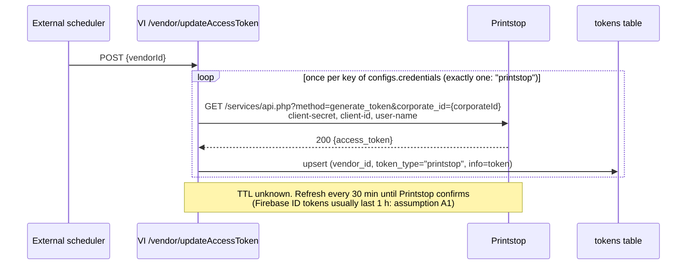
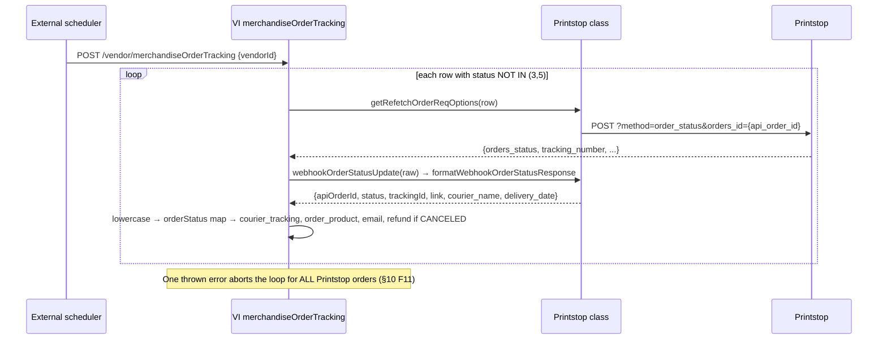

# Printstop / Mandaala: technical spec (v2)

| | |
|---|---|
| Source | Printstop/Mandaala API Reference (HTML, reviewed 2026-10-18) |
| Contract | `references/connector_reference.md` (merch-sensei, vendor-integrations `canvas`, Oct 2026) |
| Status | Docs reviewed. Sandbox not run (no credentials). **Code wins over this file.** |
| Companion files | `tech.json`, `vendor_config.draft.json`, `Printstop.postman_collection.json`, `code/`, `TEST_PLAN.md`, `DEBUG_RUNBOOK.md`, `HANDOFF_MERCH_SENSEI.md`, `fixtures/` |

---

## 0. Summary

**Buildable once 3 things are answered.** Order placement, polling and tracking map cleanly onto
`VendorMerchandiseClass`. Printstop's status field is literally `orders_status`, the field the base
polling loop reads, so no override is needed. Three design-level issues decide whether this is safe
to run at volume:

| # | Issue | Why it matters | Closes |
|---|---|---|---|
| 1 | **The order `profile` is the recipient.** `shipping` has no name or phone fields, so the courier label can only come from `profile` (first_name, last_name, mobile_number, email). | The duplicate rule ("one order per user"), recipient emails from Printstop, and user accounts all hang off the recipient's email. See §5.2. | STS/IDM questions Q1-Q3 |
| 2 | **No safe retry.** `reference_number` is optional, never echoed and not searchable. The 409 is keyed on the user, not the reference. | A timeout can neither be confirmed nor safely retried, and a 409 can point at a *different* reward's order (false match). See §11. | IDM-01, IDM-02, IDM-03 |
| 3 | **Status list incomplete.** Only `In Production` (id 10) is documented. | Unmapped statuses update tracking only. Orders never reach 3/5, so they poll forever. See §6. | STS-01, STS-02 |

Also: **Printstop may already be integrated** (karma defines `PRINTSTPMERCHANDISE_VENDOR_ID`). See §1 before writing code.

---

## 1. Check first: existing connector

merch-sensei Phase 3C anchors new karma defines "after `define('PRINTSTPMERCHANDISE_VENDOR_ID', …)`",
and says "Printstop and Sharaf DG follow the same pattern" as DPanda. So a Printstop vendor exists in
karma, and probably in VI. Run this before anything else:

```bash
# vendor-integrations
git grep -n -i "printstop" -- src tests
grep -n -i "printstop" src/configs/baseConfigs.json.sample
# karma
git grep -n "PRINTSTPMERCHANDISE_VENDOR_ID" -- karma
# order-process-ms
git grep -n -i "printstop" -- src/configs
```
```sql
SELECT vendor_id, category_type, supports_currency_in_api, default_product_currency FROM vendor WHERE LOWER(name) LIKE '%printstop%';
SELECT * FROM vendor_to_model WHERE vendor_id = :vid;
SHOW TABLES LIKE '%printstop%';
```

| Finding | Then |
|---|---|
| A VI class exists | Treat this spec as a **diff**: 401→409 duplicate change ("Duplicate Order Handling" section), new `order_status` fields, token flow. Do not create `Printstop.ts` twice (`integratedVendors/index.ts` auto-discovers files; two classes means a registry clash). |
| Only karma exists (manual vendor) | Build the VI class; reuse the karma vendor id, tables and listing page (do not re-add karma defines). |
| Nothing exists | Full build per this spec, including karma Phase 3C. |

---

## 2. Feasibility

```
━━━━━━━━━━━━━━━━━━━━━━━━━━━━━━━━━━━━━━━━━━━━━━━━━━━━━━━━━━━━━━━━━━━━━━━━━━━━━━━━━━━━
Printstop: feasibility (docs only)
━━━━━━━━━━━━━━━━━━━━━━━━━━━━━━━━━━━━━━━━━━━━━━━━━━━━━━━━━━━━━━━━━━━━━━━━━━━━━━━━━━━━
AUTH             ⚠️ JWT (Firebase OAuth2) via GET generate_token → tokens table (one credentials key).
                    TTL not documented. Business calls need Bearer + client-id + client-secret.
ORDER            ✅ POST method=order → orders_id. Async → iswebhookConfiration: true.
IDEMPOTENCY      ❌→⚠️ reference_number optional, not echoed, not searchable; 409 keyed on user.
ADDRESS          ✅ address maps; recipient name/phone go in profile (no name in shipping).
                    country numeric (99 = India only documented).
STATUS MAP       ⚠️ 1 of N statuses known.
WEBHOOK          ➖ none.
POLLING          ✅ order_status → top-level orders_status (base default). Single-order only.
PRE-CONFIRM FAIL ⚠️ unknown whether an accepted order can be rejected (order approval exists in
                    create_user: orderapproveruserid).
TRACKING         ✅ tracking_number, tracking_url, shipping_company, orders_due_date, actual_delivery_date.
CANCEL/RETURNS   ⚠️ no cancel/returns API (platform has no outbound cancel anyway).
CATALOG          ⚠️ listing (total, no paging) + details per product (selector undocumented);
                    no price, brand, stock; personalisation templates.
BALANCE          ➖ none → no karma_reports module.
SANDBOX RUN      0/12 (no credentials).
COMPLEXITY       Medium-High: nested body, token + 2 static headers, N+1 sync, fixedSku amounts by hand,
                 recipient-as-user model, no safe retry.
━━━━━━━━━━━━━━━━━━━━━━━━━━━━━━━━━━━━━━━━━━━━━━━━━━━━━━━━━━━━━━━━━━━━━━━━━━━━━━━━━━━
```

---

## 3. Architecture and flows

### 3.1 Token


### 3.2 Place order (happy path, timeout, duplicate)
```mermaid
sequenceDiagram
    participant OPMS
    participant VI as VI procureVoucherFromVendor
    participant C as Printstop class
    participant PS as Printstop
    participant DB as merchandise_vendor_order_details
    OPMS->>VI: POST /vendor/procure_voucher (hash)
    VI->>VI: duplicate guard (OPM00063)
    VI->>C: getPlaceOrderReqOptions(data)
    C->>PS: POST ?method=order {profile, product, shipping, corporate_billing_id}
    alt 200
        PS-->>C: {success:"true", orders_id}
        C-->>VI: formatOrderResponse → code printstop_merchandise_vendor_{id}, apiOrderId
        VI->>DB: insert row (status 1); egift row deferred (iswebhookConfiration)
    else 409 (same user already ordered)
        PS-->>C: {success:false, orders:[id]}
        C->>C: errorHandler: NOT auto-linked (false-match risk §11.2) → fail to manual review
    else timeout / 5xx
        C-->>VI: error → order NOT confirmed. No lookup by reference exists (§11.1)
    end
```

### 3.3 Status updates (polling only)


### 3.4 Catalogue sync
```mermaid
sequenceDiagram
    participant SCH as External scheduler
    participant BC as VI sync_products
    participant C as Printstop class
    participant PS as Printstop
    SCH->>BC: POST /vendor/sync_products {vendorId}
    BC->>C: getVendorProducts()
    C->>PS: POST ?method=product_listing
    PS-->>C: {total, data[]}
    C->>C: assert data.length === total else throw
    loop each product_id
        C->>PS: POST ?method=product_details (&product_id=? undocumented)
        PS-->>C: product_details
    end
    C-->>BC: formatProductResponse → one row per size
    BC->>BC: TRUNCATE printstop_merchandise_products + insert; vanished SKUs disabled
    Note over C,BC: Any failed call MUST throw, or the truncate disables the catalogue
```

---

## 4. Endpoint contracts

All calls: `{baseUrl}/services/api.php?method=<op>`. Sandbox `https://www.psstaging.in`; production TBD.
Business-call headers: `Authorization: Bearer <token>`, `client-secret`, `client-id`
(+ `Content-Type: application/json` when there is a body).

### 4.1 generate_token: `GET ?method=generate_token&corporate_id={int}`
| Header | Value |
|---|---|
| client-secret / client-id / user-name | from credentials (`user-name` = client email) |

| Response field | Type | Notes |
|---|---|---|
| success | string `"true"` | not boolean |
| status | int 200 | |
| access_token | string (JWT RS256) | TTL not documented |

Errors: 401 (bad credentials).

### 4.2 order: `POST ?method=order`
| Body path | Type | Req | Notes |
|---|---|---|---|
| profile.first_name / last_name | string | Y / Y | "person placing the order", but it is also the only recipient-name source |
| profile.email | string | Y | user identity: drives "one order per user" (§5.2) |
| profile.mobile_number | string | Y | format not stated |
| profile.company_name | string | Y | constant |
| profile.corporate_id | int | Y | constant (credentials) |
| profile.reference_number | string | N | "unique"; uniqueness not enforced or echoed |
| profile.department_id | int | N | 0 |
| product.product_id | int | Y | from catalogue |
| product.size_id | int | N | from product_details.product_size |
| template.template_id + block fields | string | cond. | required for personalised products; upload_image = base64 |
| corporate_shipping_id **or** shipping{address_line_1, address_line_2, city, state, pincode, country} | string / object | Y | country int (99 India) |
| corporate_billing_id **or** billing{…} | int / object | Y | constant location code |

| Response | Shape |
|---|---|
| 200 | `{success:"true", status:200, orders_id:int}` |
| 409 | `{success:false, status:409, message:"Order already placed for this user.", orders:[int]}` (was 401 before; a feature flag keeps the old behaviour) |
| 400 / 401 / 500 | `{success:false, status, message}` |

No quantity field: one call = one item.

### 4.3 order_status: `POST ?method=order_status&orders_id={int}` (no body)
| Field | Type | Use |
|---|---|---|
| orders_id | int | apiOrderId |
| orders_status_id | int | statusCode |
| orders_status | string | status (lowercased by base) |
| orders_date_finished | "DD Mon, YYYY" | placed/finished date (ambiguous) |
| orders_due_date | "DD Mon, YYYY" | estimatedDelivery |
| actual_delivery_date | "DD Mon, YYYY" or "" | delivery_date |
| tracking_number / tracking_url / shipping_company | string or "" | trackingId / link / courier_name |
| email_id, internal_notes | string | PII / ignore |

Unknown order: not documented.

### 4.4 product_listing: `POST ?method=product_listing`
`{success, status, total:int, data:[{product_id:int, name, status:"Active"|…}]}`. No paging. The
example shows two ids with the same name (7422, 8093), so variants may also be separate products.

### 4.5 product_details: `POST ?method=product_details`
Doc says "Body: None" and lists no selector, so assume `&product_id=` (**verify, A4**). Key fields:
product_id, product_name, product_short_des (price range in HTML), product_long_des, product_image
(`{cdnurl}` prefix), category_id, visible, price_defining_method, tax_details (CGST/SGST/IGST),
product_hsn, product_size[{size_id, size_title, size_unit, visible}], product_production_days[{size_id,
production_days}], product_images[], templates[{template_id, blockN_name, blockN_type}].

### 4.6 category_listing / create_user
category_listing: `{total, data:[{category_id, parent_id, category_name, status, …}]}`, used for category names.
create_user: everything in the **query string** (email, phone, address), plus `numorders` (order limit
per user) and `orderapproveruserid` (approval workflow). Only needed if Q3 says orders require a user.

### 4.7 Cross-cutting quirks
- `success` is `"true"` (string) on success and `false` (boolean) on error: branch on the HTTP status.
- One path for every operation, so Mongo call logs must keep the `method` query param to stay readable.
- The doc text was find-and-replaced ("dev@Printstop/Mandaala.co.in" is not a valid email), so the
  examples are illustrative, not copy-paste safe.

---

## 5. Data mapping

### 5.1 Order body (`getPlaceOrderReqOptions`)
| Printstop | Source | Rule |
|---|---|---|
| profile.first_name | `shipping_firstname` | trim |
| profile.last_name | `shipping_lastname` | empty → `shipping_firstname` (required) |
| profile.email | see §5.2 | decision D1 |
| profile.mobile_number | `shipping_contact_no` ‖ `recipientMobileNumber` | digits only, last 10 for India (A6) |
| profile.company_name | `credentials.printstop.companyName` | constant |
| profile.corporate_id | `credentials.printstop.corporateId` | Number() |
| profile.reference_number | `externalOrderId` (voucher_insert_id based) | String(); sent even though optional |
| profile.department_id | `0` | |
| product.product_id / size_id | sku `"{product_id}_{size_id}"` | split; omit size_id if absent |
| template | none | personalised products are excluded from sync (§5.4) |
| shipping.address_line_1/2 | `shipping_address_1` / `_2` | `_2` empty → "" |
| shipping.city / state / pincode | `shipping_city` / `shipping_zone` / `shipping_postcode` | state = name |
| shipping.country | `shipping_country_id` | map to Printstop code; only India (99) allowed until confirmed; else throw before the call |
| corporate_billing_id | `credentials.printstop.corporateBillingId` | Number() |

### 5.2 Recipient identity (decision D1)
`profile` is both "the person placing the order" and the only source of the recipient's name and
phone. Two models are possible, and Printstop must say which one our store uses:

| Model | profile.email | Pros | Cons |
|---|---|---|---|
| **A. One API user** | `credentials.printstop.orderEmail` (ours) | No recipient emails from Printstop; no user creation | On a one-order-per-user store **every order after the first gets a 409**; a name/phone on the label that differ from the user may be rejected |
| **B. Recipient as user** | recipient email (order option "Receiver's Email", if present in the procure data: A7) | Natural on B2B stores | Printstop may email recipients (white-label, ORD-10); repeat recipients hit the 409; may need `create_user` first (`numorders`) |

Recommendation: **Model A**, with Printstop confirming that our store has no per-user limit and no
approval step. Then the 409 can only mean a real duplicate (§11).

### 5.3 Status, tracking, dates (`formatWebhookOrderStatusResponse`, polling shape)
| Ours | Printstop | Rule |
|---|---|---|
| apiOrderId | orders_id | String() (must equal `merchandise_vendor_order_details.api_order_id`) |
| externalOrderId | none | "" (not echoed) |
| status / statusCode | orders_status / orders_status_id | raw; base lowercases and maps |
| trackingId / link / courier_name | tracking_number / tracking_url / shipping_company | "" until dispatch |
| dispatched_date | none | "" (orders_date_finished is ambiguous: A8) |
| delivery_date | actual_delivery_date | parse "DD Mon, YYYY", IST (A9); "" → "" |

### 5.4 Product (`formatProductResponse`)
| Column (`printstop_merchandise_products`) | Source | Rule |
|---|---|---|
| sku | product_id + size_id | `"{product_id}_{size_id}"`; no sizes → `"{product_id}"` |
| name | product_name + size_title | `"{name} - {size}"` when sized |
| image | product_image | replace `{cdnurl}` (base URL: Q5) |
| description | product_long_des | HTML kept |
| categories | category_id → category_name | via category_listing |
| status | visible && size.visible | "Active" → 1 else 0; **templates with an image block → 0** (we cannot supply personalisation) |
| brand | none | "" (column must exist for the karma listing) |
| denominations / min_price / max_price | none in API | blank; amounts entered in karma (fixedSku Variant B) |
| currency / country | none | "INR" / "IN" only after Q6 |
| terms_conditions / how_to_use | none | "" |
| extra (optional) | product_hsn, tax_details, production_days | store if `extraInfo` is enabled |

---

## 6. State machine

```
Printstop orders_status (lowercased)  → deliveryStatus → mvod.status → side effects
──────────────────────────────────────────────────────────────────────────────────────────
"in production" (10)                  → CONFIRMED      → 1          → egift row created (async vendor), email
<placed/approved?>                    → PENDING        → 1          → none
<dispatched/shipped?>                 → SHIPPED        → 2          → courier_tracking, email (egift row if not yet)
<delivered?>                          → DELIVERED      → 3          → final; polling stops
<cancelled/rejected?>                 → CANCELED       → 5          → refund_ms addOrderToRefundQueue; polling stops
<returned/rto?>                       → RETURNED       → 10         → email only, NO refund; polling CONTINUES (NOT IN (3,5))
anything else                         → (unmapped)     → unchanged  → tracking only; log "Printstop: unmapped webhook status"
```
Rows in `<…>` are expected but **not documented** (Q1). Two consequences:
- RETURNED (10) is not terminal for the polling query, so returned orders are polled forever.
  Ask whether returns happen at all; if they do, raise a base change (excluded statuses).
- If Printstop has an "on hold / awaiting approval" status, map it to PENDING, never to CANCELED.

---

## 7. Class plan: `src/vendors/integratedVendors/Printstop.ts`

Draft code: `code/Printstop.ts` (verify signatures against the base classes first). Rules: extend
`VendorMerchandiseClass`; `Helper.makeRequestWithAxios` only (raw axios skips call logging); `logger`,
never `console`; `max-len 120`; `max-lines-per-function 120`; 2-space indent; `noUnusedLocals`.

| Method | Behaviour | Throws when |
|---|---|---|
| `fetchAccessToken(key)` | GET generate_token with the `credentials[key]` headers; return `access_token` | non-200 / no token |
| `getReqHeaders(data)` | Bearer (`getAccessTokenFromDb(vendorId, "printstop")`) + client-id + client-secret + JSON | no token row (OPM00015 path) |
| `getPlaceOrderReqOptions(data)` | `{url: "/services/api.php?method=order", method: "POST", body}`; helpers `buildProfile`, `buildProduct`, `buildShipping` | country ≠ India; bad sku |
| `formatOrderResponse(res, data)` | code `printstop_merchandise_vendor_{orders_id}`, apiOrderId, `addedBy "Printstop API"` (must equal `${vendorData.name} API`) | no `orders_id` → `throw res` |
| `getVoucherValidity()` | `""` | |
| `errorHandler(err, data)` | 409 → log the `orders[]` ids and rethrow as a non-retryable failure (manual review) **unless** Q2 confirms a reference-keyed 409, then `callVendorRefetch`; others → `super.errorHandler` | |
| `getRefetchOrderReqOptions(row)` | `orders_id = row.api_order_id`; only `externalOrderId` → throw a clear error (no reference lookup) | no api_order_id |
| `formatWebhookOrderStatusResponse(d)` | §5.3; unknown status returned raw | missing `orders_id` only |
| `fetchTrackingDetailsFromVendor(orders)` | order_status per order product → `{trackingId, trackingUrl, courierName, estimatedDelivery}` | |
| `getVendorProducts()` | listing → assert count → details per id (sequential, `maxApiAtaTime` 1) → flatten sizes | any failure |
| `formatProductResponse(p)` | §5.4 | |
| `formatWebhookProductResponse()` | `{sku: "", status: 2}` (documented no-op) | |

Types: `src/vendors/vendorTemplates/printstopTypes.ts` with the response interfaces in §4 (only
types actually used).

---

## 8. Config and registration

| Where | Change | Tracked? |
|---|---|---|
| VI `src/configs/vendorConfigs/Printstop.json` | `vendor_config.draft.json`: `merchandiseVendor: true`, `iswebhookConfiration: true`, `fixedSku` + `skuTable`, refetch + token + listing blocks, **credentials nested under one key `printstop`** (updateAccessToken calls `fetchAccessToken` once per key) | No (gitignored) |
| VI `baseConfigs.json` (+ `.sample`) | `vendorClassIdMapping."Printstop"`; `merchandiseOrderTrackingVendorIds += id`; `vendorCallLogger.mongo.redactHeaders += ["client-secret","client-id","user-name"]`; `allowMerchandiseEmailClientIds` if Plum Pro (store 4) clients get this vendor | sample yes |
| VI | `npm run merge-configs` (never hand-edit `config.json`) | |
| OPMS `config_voucher_process.json` | `vendorIntegration.integratedVendors += "<id>"` (string), `vendorIdsWithName["<id>"] = "Printstop"`; hashKey/hashSalt = VI voucherProcure | deploy config |
| plumAuth | nothing (no webhooks) | |
| Schedulers | `/vendor/updateAccessToken` (seed once, then every 30 min), `/vendor/sync_products` (daily), `/vendor/merchandiseOrderTracking` (every 30-60 min) | ops |
| DB | `vendor` row, `vendor_to_model`, `product_api_model_names`, `printstop_merchandise_products`, `printstop_merchandise_product_to_denominations` (`CREATE TABLE … LIKE dpanda_*`); **check existing first (§1)** | ops |
| karma | define exists; verify listing page, `getRoutes`, header menu, `FIXED_SKU_VENDORS ", <id>"`, product-form SKU tab, User Group permission on every env branch | per env |
| karma_reports | none (no balance API) | |

---

## 9. Data model

| Table | Key columns used | Notes |
|---|---|---|
| `printstop_merchandise_products` | sku, name, image, denominations, is_variable, min_price, max_price, description, terms_conditions, status, categories, how_to_use, country, currency, brand | truncated and reloaded by every sync |
| `printstop_merchandise_product_to_denominations` | product_id, sku, amount | written by the karma product form; the amount must match the order amount (else OPM00002) |
| `merchandise_vendor_order_details` | api_order_id (= orders_id), insert_id, status 1/2/3/5/10 | one row per order product |
| `egift_voucher_details` | api_order_id, added_by = "Printstop API" | created on CONFIRMED/SHIPPED |
| `courier_tracking` | tracking id/url/courier | from polling |
| `tokens` | vendor_id, token_type "printstop", info | never select `info` |

---

## 10. Failure modes

| # | Step | Failure | Detection | Handling | Severity |
|---|---|---|---|---|---|
| F1 | token | generate_token 401 (rotated secret) | updateAccessToken error, all calls 401 | alert; update credentials via devx | High |
| F2 | token | token expires between refreshes | business call 401 | refresh cadence < TTL; base 401 path (verify A2) | Medium |
| F3 | order | 400 missing/invalid field | OPM error, vendor_call_logs | validate before the call (country, last name, sku format) | Medium |
| F4 | order | 409 same user (Model B or a per-user store) | errorHandler | manual review; never auto-link (§11.2) | High |
| F5 | order | timeout / 5xx after Printstop created the order | OPMS failure, possible ghost order | no blind retry; manual reconcile by email/reference with Printstop (§11.1) | High |
| F6 | order | personalised product ordered without a template | 400 or wrong print | excluded at sync (status 0) | Medium |
| F7 | order | non-India address | pre-call throw | block in mapping until Q6 | Low |
| F8 | order | amount mismatch between karma denomination and order | OPM00002 | keep karma amounts in sync with Printstop prices (Q6) | Medium |
| F9 | polling | unmapped status | "unmapped webhook status" log | add the lowercase key; alert on new values | Medium |
| F10 | polling | order never terminal (stuck / RETURNED) | rows NOT IN (3,5) grow | ageing alert > due date + 7 days | Medium |
| F11 | polling | one order_status call throws | loop aborts for **all** Printstop orders | formatter never throws on unknown values; catch 4xx per order (verify base loop A3) | High |
| F12 | polling | status emails re-sent every poll | duplicate customer emails | suspected base bug `order.order_Product_Id` casing (MC ~:1040): verify before go-live; polling-only vendors are most exposed | High |
| F13 | sync | details call fails mid-loop | `received N` ≠ `Formatted N` | throw so the truncate never runs on partial data | High |
| F14 | sync | listing `total` ≠ `data.length` (hidden paging) | assertion | throw; ask Q7 | Medium |
| F15 | sync | `{cdnurl}` not resolved | broken images | replace before insert; fail sync if the base is unknown | Low |
| F16 | tracking | cached tracking > 1 day | refresh path | `fetchTrackingDetailsFromVendor` implemented | Low |

---

## 11. Idempotency and retry

### 11.1 Timeout without an order id
After a timeout we hold `externalOrderId` only. Printstop has no lookup by reference, so
`getRefetchOrderReqOptions` cannot work from `voucherReqDataFormat`. Until Printstop adds a lookup or
a reference-keyed 409:
1. Do not retry automatically (OPMS must treat this as failed or pending manual review, not retryable).
2. Ops reconcile with Printstop by `reference_number` (we always send it) or by recipient email and date.
3. Ask for a lookup by reference (Q2). With it, refetch becomes `order_status&reference_number=…` and retries are safe.

### 11.2 409 false match
The 409 returns the user's *existing* orders. Under Model B (or any store with a per-user limit), a
second, legitimate reward to the same email returns the first reward's `orders_id`. Linking it via
`callVendorRefetch` would mark two rewards as fulfilled by one shipment. Rule: **never** auto-link a
409 unless Printstop confirms that the 409 is keyed on `reference_number`. In that case, also
compare the returned order's reference before linking.

### 11.3 Our own guard
VI's merchandise duplicate guard (OPM00063) stops the same order product being procured twice. It does
not protect against the vendor-side ghost order in 11.1.

---

## 12. Security and PII

- Secrets: `client-secret`, `client-id` and the JWT go in headers on every call, so redact all three
  (+ `user-name`) in `vendorCallLogger.mongo.redactHeaders`. Staging values only in the gitignored
  vendor config. Placeholders everywhere tracked.
- PII sent: recipient name, phone, email, address (profile + shipping). Printstop returns `email_id`
  in order_status, so it lands in logs: mask it in debug output.
- `create_user` (if ever used) puts email, phone and address in the **URL query**. URLs end up in
  proxy/access logs, so avoid it, or ask for a POST body.
- Transport: HTTPS only (sandbox confirmed). DPA / retention: ask (SEC-02).

---

## 13. Performance and limits

| Item | Value | Impact |
|---|---|---|
| Order call | 1 item per call; latency not stated (must be ≤120 s, ORD-11) | `maxCardsPerRequest: 1` |
| Polling | 1 call per open order per run | 1,000 open orders, hourly → 24k calls/day; ask about rate limits (POL-03) |
| Sync | 1 + N calls (N products), sequential | 500 products ≈ 500 calls per sync; consider `VendorBatchSyncClass` if large |
| Rate limits | not documented | start with `maxApiAtaTime: 1` |

---

## 14. Observability

| Signal | Source | Alert |
|---|---|---|
| Token refresh failure | updateAccessToken logs | immediately |
| Order failures by code (400/401/409/5xx) | vendor_call_logs (apiType placeOrder) | 409 rate > 0 (investigate), 5xx > 2% |
| Unmapped statuses | "Printstop: unmapped webhook status" | any new value |
| Polling loop aborted | "Error while Merchandise order tracking" / Teams card | immediately |
| Open orders past due date + 7 days | SQL on mvod + order_status due date | daily |
| Sync count drift | `received N` vs `Formatted N` | any mismatch |

Log every call with `method` (operation), orders_id and voucher_insert_id. Never log the token or PII.

---

## 15. Test strategy

`TEST_PLAN.md` has the details. Sandbox first: 12 Postman requests including duplicate, invalid
product, missing address, expired token and unknown order, plus manual checks (latency, same-email
second order, dispatch simulation). Then Jest: the `code/Printstop.test.ts` skeleton covers every
formatter, mapping and error path, using `fixtures/`.

---

## 16. Rollout and rollback

1. Staging: full Postman run, then Jest, then the staging smoke (order → poll → 1 → 2 → 3, courier_tracking row).
2. UAT with a small product subset (sync filter), 5-10 real-address test orders agreed with Printstop (not billed).
3. Production: enable in OPMS `integratedVendors` for one client or campaign first; watch §14 for 1 week.
4. Rollback: remove the id from OPMS `integratedVendors` (orders go back to manual), stop the
   tracking scheduler only after open orders close, keep the VI config (harmless when unused).

---

## 17. Effort

| Work | Estimate |
|---|---|
| §1 existing-connector check | 0.5 day |
| Class + types (new build) | 2-3 days (diff only: 1 day) |
| Config, registration, schedulers | 0.5 day |
| Jest suite | 1 day |
| Sandbox run + fixes | 1 day (plus vendor wait) |
| karma (if not present) | 1-2 days per env branch set |
| UAT + rollout | 2-3 days |
Estimates assume answers to Q1-Q3 are in hand.

---

## 18. Assumption ledger

| # | Assumption | Risk if wrong | How to verify |
|---|---|---|---|
| A1 | Token TTL ≈ 1 h (Firebase ID tokens usually last 1 h) | Mass 401s | Ask Printstop; decode `exp` in a sandbox token |
| A2 | Base `errorHandler` on 401 refreshes or fails cleanly | Orders fail until the next refresh | Read `vendorBaseClass.errorHandler` on the branch |
| A3 | Polling loop aborts on a thrown error (merch-sensei: "one bad order aborts the vendor loop") | All tracking stops | Read `vendorMerchandiseClass` tracking loop; test with an unknown orders_id |
| A4 | product_details takes `&product_id=` | Sync cannot fetch details | Postman request 03 |
| A5 | Printstop statuses include dispatched / delivered / cancelled / returned equivalents | Wrong mapping | Q1 |
| A6 | Indian mobile numbers are accepted as 10 digits | 400 on orders | Sandbox order with various formats |
| A7 | Recipient email ("Receiver's Email" option) reaches VI in the procure data | Model B impossible | Inspect a `procure_voucher` payload in VI logs |
| A8 | `orders_date_finished` is the placement date, not dispatch | Wrong dispatched_date | Ask Printstop |
| A9 | Dates are IST | Off-by-one delivery dates | Ask Printstop |
| A10 | Sandbox orders are not shipped or billed | Real cost from tests | ENV-06: ask before the first sandbox order |

---

## 19. Open questions

| # | Question | Blocks | Check |
|---|---|---|---|
| Q1 | Full `orders_status_id` / `orders_status` list with meanings (incl. hold/approval, cancelled, returned) | go-live | STS-01, STS-02 |
| Q2 | Is `reference_number` unique, with a 409 on reuse? Can order_status look up by `reference_number`? | safe retry | IDM-01, IDM-02, IDM-03 |
| Q3 | Our store: per-user order limit? approval workflow? must the profile email be an existing user (create_user)? | design D1 | CAT-14, ORD-13 |
| Q4 | Quantity always 1? | mapping | ORD-09 |
| Q5 | product_details selector; `{cdnurl}` base | sync | CAT-04, DOC-02 |
| Q6 | Exact price per product/size, currency, GST/shipping included, countries other than India | pricing | PRC-01, PRC-02, ENV-05 |
| Q7 | Token TTL, rate limits, paging for product_listing | ops | AUTH-02, ERR-04, CAT-02 |
| Q8 | Do recipients get emails or SMS from Printstop? Can they be turned off or white-labelled? | recipient experience | ORD-10 |
| Q9 | Returns / RTO process and status | ops | RTN-03, RTN-04 |
| Q10 | Sandbox credentials; are sandbox orders free? | testing | ENV-01, ENV-06 |

---

## 20. Done means

- [ ] §1 resolved (new build vs diff) and recorded in the PR description.
- [ ] Q1-Q3 answered; `status_map` complete; D1 decided.
- [ ] Sandbox: 12/12 Postman requests pass; manual checks done; fixtures replaced with redacted sandbox responses.
- [ ] `npm run merge-configs && npx tsc && npm run lint && npx jest tests/vendors/printstop` green.
- [ ] `git status` shows the vendor config not staged; no secrets in tracked files.
- [ ] Staging smoke: mvod 1 → 2 → 3, courier_tracking row, email sent once (F12 checked).
- [ ] Alerts in §14 configured; rollback steps rehearsed.
